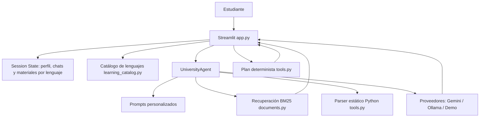

# CampusIA CodeMentor — Arquitectura técnica

## Objetivo

Asistente guiado para aprender lenguajes de programación, con una interfaz de chat conversacional, lectura de apuntes, retos, revisión de código y plan diario de estudio.

## Diagrama

## Componentes

- **app.py**: navegación lateral, perfil (lenguaje, nivel, objetivo), chat tipo mensajería, panel de materiales, plan y práctica.
- **assets/styles.css**: diseño oscuro, burbujas, espaciado y adaptación a móviles.
- **learning_catalog.py**: temas graduados y snippets iniciales para Python, JavaScript, TypeScript, Java, C++, C#, SQL, Go, Kotlin y Rust.
- **models.py**: `StudentProfile`, `KnowledgeChunk`, `AgentResponse`.
- **prompts.py**: identidad del mentor, reglas didácticas, referencias a materiales e instrucciones contra prompt injection.
- **agent.py**: coordina chat, fragmentos recuperados, revisión local Python, retos. La decisión de herramientas es determinista, no function calling autónomo.
- **documents.py**: ingesta de PDF, DOCX, TXT y MD; normalización, fragmentación y búsqueda BM25, con fuente y página cuando aplica.
- **tools.py**: rutas personalizadas de 1–45 días, sintaxis de Python con `ast.parse`, retos plantillas en modo demo.
- **providers.py**: puertos adaptadores para Ollama, Gemini y modo de demostración no generativo.
- **config.py**: `GEMINI_API_KEY` opcional y URL del cliente local `CAMPUSIA_OLLAMA_URL`, distinta de `OLLAMA_HOST`.

## Flujo de conversación

1. El estudiante elige un lenguaje, nivel, objetivo y estilo de explicación.
2. Streamlit recupera **el chat y los apuntes del lenguaje seleccionado** de la sesión.
3. `UniversityAgent.chat` detecta bloques de Python para revisar sintaxis sin ejecución.
4. Con material cargado, `retrieve` puntúa coincidencias BM25 y selecciona hasta tres fragmentos.
5. `system_prompt` transmite al LLM el perfil didáctico; los apuntes se etiquetan como datos no confiables.
6. El proveedor genera una explicación. En modo demo solo muestra material o instrucciones generales sin fingir IA.
7. La interfaz muestra texto y, si corresponde, un desplegable discreto **Material consultado**, sin exponer trazas internas.
8. La conversación queda en memoria de la sesión y puede exportarse.

## Límites

- Sin ejecución de código de estudiantes, sin autenticación, sin OCR, sin persistencia en una base de datos, sin navegación web.
- Revisión sintáctica real solo para Python; para otros lenguajes el análisis del modelo no garantiza compilar.
- Los documentos en Gemini salen del servidor hacia Google; en Ollama se envían al servidor configurado (usualmente localhost).
- BM25 es recuperación léxica, no búsqueda vectorial. Se puede ampliar con embeddings y un almacén vectorial en una fase posterior.
- Cada chat y conjunto de documentos están separados **dentro de una misma sesión de Streamlit**, no entre usuarios autenticados.

## Puntos de extensión

1. Agregar un lenguaje a `learning_catalog.py` con temario y snippet.
2. Crear una herramienta sintáctica para otro lenguaje, usando un analizador seguro y sin ejecutar código arbitrario.
3. Guardar sesiones de forma autenticada y privada en una base de datos.
4. Generar y evaluar retos en una segunda etapa con pruebas unitarias controladas y sandbox aislada.
